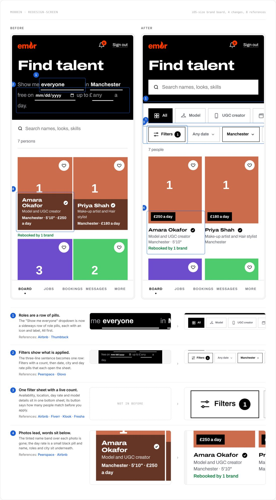
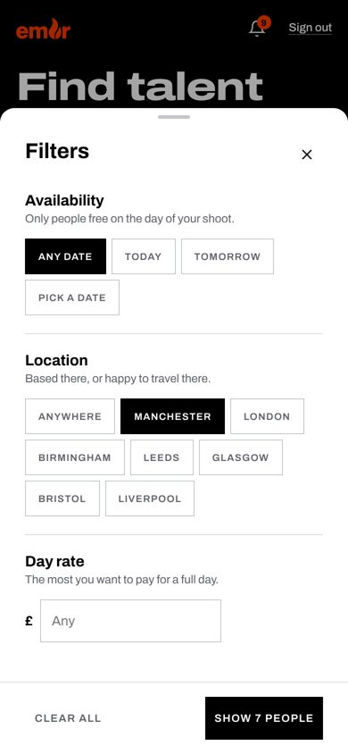

# Brand board as a native phone screen (D8)

Date: 2026-11-25. Asked by Luke: research how multi-category marketplaces switch top-level categories and filter results, then rebuild the brand board (`/board`, "Find talent") as a native mobile screen following `DESIGN_RULES.md`.

Brand-only: talent have no board, cannot browse briefs and cannot apply (CLAUDE.md hard rule 2). Payments are untouched.

**Status: held for Luke's final UI round.** Luke said on 2026-11-25 that all UI fixes land together at the end of the research, so this PR is not merged or deployed yet.

## Mobbin evidence (iOS, checked 2026-11-25)

Mobbin's MCP search covers iOS and web only, so there is no Android evidence here. Android touch size follows `DESIGN_RULES.md` 2.2 (48px, from Google's guidance linked there).

| Decision | Screens |
|---|---|
| Top-level categories as one sideways row of pills, icon plus label, "All" first, selected pill filled | [Airbnb Explore](https://mobbin.com/screens/ac9f97e3-7584-4f76-8915-71d1eeca7a45) (All, Homes, Experiences, Services) · [Thumbtack "High-rated pros"](https://mobbin.com/screens/10f7c91d-6603-48c0-b1ea-a10d0f0afe83) (Cleaners, Plumbers, Movers) |
| Applied filters shown as a row of pills above results, a Filters pill with a count badge | [Peerspace search](https://mobbin.com/screens/294b057a-3b87-4155-99a2-37052927e47f) ("When", "Filters 6", "Classroom") · [Glovo](https://mobbin.com/screens/f1630376-de8f-450a-a695-5c18530ab891) ("Food type 4", "Ratings") |
| One filter sheet: title and X at top, sections split by rules, sticky footer with a text "Clear all" and a black button that states the match count | [Airbnb filters](https://mobbin.com/screens/48992aea-f113-4e2b-98e9-9de88e38e136) ("Show 305 places") · [Fiverr filters](https://mobbin.com/screens/20898d2e-4743-41f7-a6d4-685afb49cda2) · [Klook filters](https://mobbin.com/screens/36216a1a-acec-4a99-8015-1262338b6af5) ("Show 9 results") · [Fresha filters](https://mobbin.com/screens/95f307d6-cfed-4784-b500-b6fa2f81d91b) · [Tripadvisor filters](https://mobbin.com/screens/85bc9bfe-26f3-4ecc-aa6b-f05f96281f8b) ("Show 5 results") |
| Dates as quick chips (Today, Tomorrow) plus a "more dates" picker | [Klook filters](https://mobbin.com/screens/36216a1a-acec-4a99-8015-1262338b6af5) · [DoorDash filters](https://mobbin.com/screens/3b6ad47c-0bed-4bb2-82c2-17593cf7b798) (Date row) |
| Location as chips | [Tripadvisor filters](https://mobbin.com/screens/85bc9bfe-26f3-4ecc-aa6b-f05f96281f8b) (Neighborhood chips) |
| A single maximum price | [Fresha filters](https://mobbin.com/screens/95f307d6-cfed-4784-b500-b6fa2f81d91b) ("Max price") · [Fiverr filters](https://mobbin.com/screens/20898d2e-4743-41f7-a6d4-685afb49cda2) (typed price fields) |
| Cards: photo first with price on a small black pill and a round heart; name and details in text under the photo | [Peerspace search](https://mobbin.com/screens/294b057a-3b87-4155-99a2-37052927e47f) · [Airbnb Explore](https://mobbin.com/screens/ac9f97e3-7584-4f76-8915-71d1eeca7a45) · DESIGN_RULES 4.4 |

Direction not taken: text tabs with an underline (Vinted, Facebook Marketplace, Superpower on Mobbin). Embr has ten roles plus All, which a tab bar cannot hold on a phone; the pill row scrolls, as Airbnb's and Thumbtack's do.

## What changed

1. **Roles are a row of pills.** The "Show me everyone" dropdown is now a sideways row: All, Model, UGC creator, Actor, Content creator, Photographer, Videographer, Make-up artist, Hair stylist, Nail technician, Stylist, each with a line icon (added to `src/icons.js` in the existing style).
2. **Filters show what is applied.** The three-line "Show me … in … free on … up to £…" sentence is replaced by one row: Filters (with a count), date, city and day rate. Each pill opens the filter sheet at its section.
3. **One filter sheet with a live count.** Availability (Any date, Today, Tomorrow, Pick a date), Location (Anywhere plus the seven pilot cities), Day rate (the most you'll pay) and, when Model is picked, Model details (sizes, dress or suit size, height). Changes stay in a draft; the button reads "Show 3 people" (or "No one matches") from the same `search_talent` call, and nothing applies until it is tapped. "Clear all" resets the draft. On phones it is a bottom sheet with rounded top corners and a grabber (DESIGN_RULES 3.1); on desktop the usual centred dialog.
4. **Photos lead, words sit below.** Board cards drop the tinted name band over the photo. The day rate is a small black pill on the photo; name, roles, city and height sit underneath (DESIGN_RULES 4.4). The save heart has a 48px tap area with a 32px white circle (DESIGN_RULES 2.2, 2.4).

Also: the count says "7 people", not "7 persons". The search field sits in the black band as one white field. An empty result offers "Clear filters" when filters are on.

Kept: the black band and "Find talent" title, the brand's to-dos at the top, the "Will travel to …" section, search by name/look/skill, the same ranking and filters in the database (no SQL change), and the shortlist screen's cards (outside this screen, untouched).

My judgement, not shown by a cited screen: pills keep Embr's square corners and the chips' uppercase style from `src/style.css` rather than Airbnb's rounded pills; the date picker opens the phone's own date control.

## Before and after

Filter sheet (phone):

## DESIGN_RULES "Current app" notes this fixes on the board

When PR #26 (DESIGN_RULES.md) is merged, delete from its "Current app" notes: the 34px save heart (board cards now have a 48px tap area) and the 30px chip height for the board's role and filter pills. The 30px `.chip` elsewhere and the text-only tab bar are outside this screen and unchanged.

## Tests

`tests/e2e.test.mjs`: board shows the role pills, filter row and rate pill; brand switches to UGC creators with a pill; new phone check that pills and hearts are at least 48px tall, the sheet has rounded corners and a grabber, the live count updates (£200 cap: "No one matches"; £300 and Today: "Show 1 person"), Show applies and the badge counts 3, Clear all returns to Anywhere and no badge.
