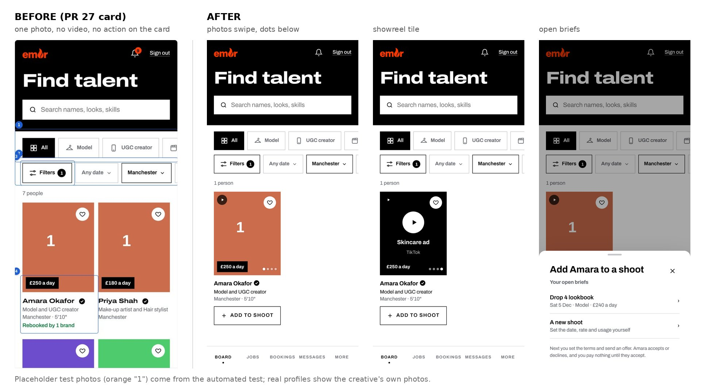

# CreativeCard: one reusable card for showing a creative to a brand

Built 2026-11-25 on top of PR 27 (mobile brand board). Held for Luke's final UI round: not merged, not deployed.

Code: `src/views/card.js` (`creativeCard(t, { save, cta })`), styles under "CreativeCard" in `src/style.css`, data from `supabase/migrations/20261125000006_card_media.sql`. The board uses it now; the shortlist and best-fit list can switch to it in the final round.

## What the card shows

| Part | What it does | Mobbin evidence (iOS) |
|---|---|---|
| Swipeable media | Up to 5 photos in profile order, swiped sideways, with dots that follow the swipe | Airbnb wishlist cards with dots under the photo ([1](https://mobbin.com/screens/f9336244-41b4-46c3-80bc-a3749c31aa4f), [2](https://mobbin.com/screens/df3523e0-6209-461c-af3a-8b2ee4cbb8ba)), Airbnb card over map ([3](https://mobbin.com/screens/ea2e0540-b4de-4683-ac7e-09e30142252f)) |
| Video preview | If the creative has a video link (showreel, UGC example, channel), the last slide is a black tile with a white play button, the video's title and where it lives (TikTok, Vimeo …). A small play badge top left says there is video before you swipe | TikTok marks video thumbnails with a play icon and count ([profile grid](https://mobbin.com/screens/dba622ca-3bb7-4944-9a5c-b484b80e3450), [creator card](https://mobbin.com/screens/fb3056c9-1a44-4769-b166-6b9183e37c21)) and a corner icon in its two-column feed ([4](https://mobbin.com/screens/d87cc8ec-9606-478c-ab05-ccbc77a7b66c)); Behance video tiles use a centred play button ([5](https://mobbin.com/screens/fe529d50-f0a6-4aca-b448-af470952af32)). Black tile follows DESIGN_RULES 4.5 |
| Day rate | Small black pill on the photo | Kept from PR 27 (Peerspace, Airbnb); DESIGN_RULES 4.2, 4.4 |
| Save | 48px heart, top right | Kept from PR 27; DESIGN_RULES 2.2, 2.4 |
| Name + rating | Name left, rating right on the same line | Airbnb ([1](https://mobbin.com/screens/f9336244-41b4-46c3-80bc-a3749c31aa4f)), Airtasker ([6](https://mobbin.com/screens/9729c7ff-a6a0-42fc-8d03-30eb6dd8734c)), Fiverr puts it first in the text ([7](https://mobbin.com/screens/9332045b-5647-480c-bd40-d4772f7b4e44)) |
| Role, city | Roles on one line (ellipsis if long), then city and height for models | Airbnb, Peerspace (PR 27) |
| Add to shoot | One full-width 48px button, brands only. Opens a short bottom sheet: the brand's open briefs, then "A new shoot". Picking one closes the sheet and opens the offer form filled from the brief | Bottom sheet for a quick choice: Peerspace "Save to board" (DESIGN_RULES P3, rule 3.1). Offer stays a full screen because it commits money (rule 3.3, no sheet on a sheet 3.5). A button on each result card: Trip.com ([8](https://mobbin.com/screens/311cc294-fbff-4f1e-906e-2741109bbace)), LinkedIn ([9](https://mobbin.com/screens/c25a6042-8bdc-4902-8284-b3078098d991)) |

Mobbin has no Android library, so all references are iOS. The 48px targets cover Android (DESIGN_RULES 2.2).

## Rating: shown only when it's real

Embr has no reviews yet, so there is no rating to show. The card shows a star, score and count only when the data has `rating` and `reviews`. Until then the right of the name shows "Rebooked by N brands" when that's true, and nothing otherwise. Adding reviews is a product decision for Luke (unverified: needs a reviews feature).

## Rules kept

- Talent never see the card's actions: the heart and "Add to shoot" only render for brands. "Add to shoot" leads to the existing offer form, so Embr's booking rules and payments are unchanged (no change to `payments.ts`).
- The new migration only adds photo paths and the first video link to the card data. Brands could already see every photo and link on the profile.
- Tapping a video tile opens the profile, where the links are. A full-screen black player (DESIGN_RULES 4.5) is still to build.

## Before and after

Tests: `npm run test:e2e` 40 passed (3 photos and a TikTok tile on Amara's card, dots move on swipe, no rating shown, 48px Add to shoot, the sheet lists the open brief and opens the offer form filled from it). `npm run test:db` 77 passed.
