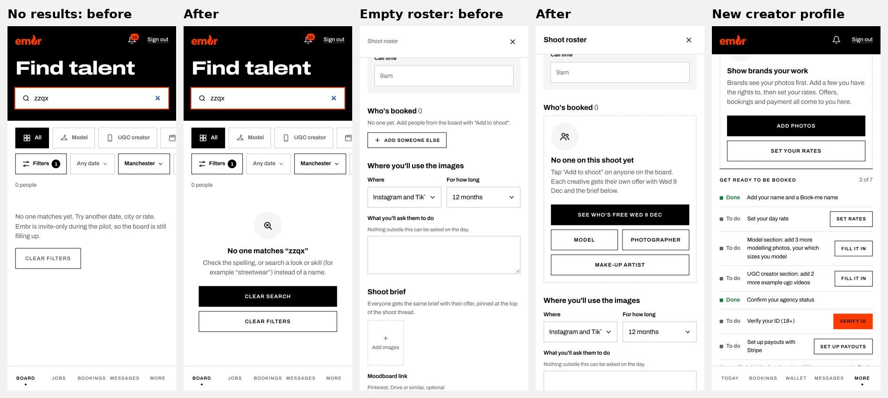
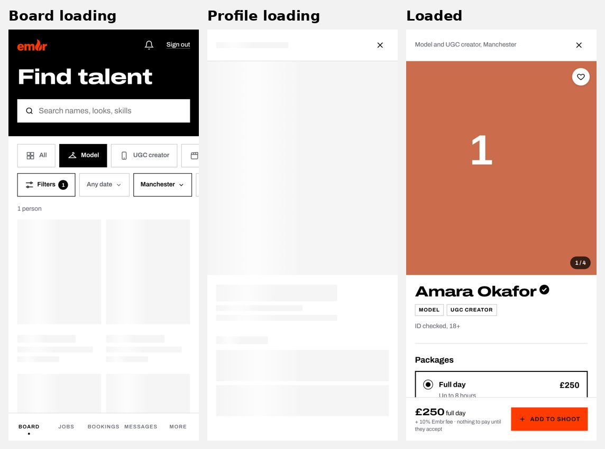
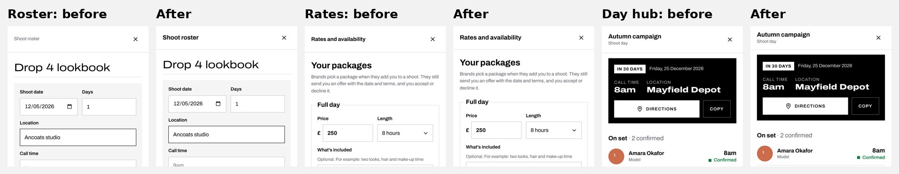

# Phone polish: type, padding, safe areas, skeletons and empty states

Status: built 2026-11-25, held for Luke's final UI round (not merged, not deployed). Stacked on PR 33 (Shoot Day Hub), the top of the parked stack (27, 28, 29, 31, 32, 33).

Luke's ask (2026-11-25): audit the new phone screens against DESIGN_RULES.md and Mobbin marketplace benchmarks, fix typography, card padding and safe-area inconsistencies, then add skeleton loaders for photo grids and empty states with clear actions for an empty Shoot Roster, zero search results and a new creator's profile.

## What the audit found and what changed

Screens audited: board (PR 27), CreativeCard (28), Shoot Roster (29), rates editor and creative detail (31), Shoot Thread and checkout (32), Shoot Day Hub (33).

| Area | Found | Now |
|---|---|---|
| Type scale | 11 sizes in the stack's CSS (11, 12, 13, 14, 15, 16, 17, 18, 20, 22, 44px), with 14, 16 and 18 used once or twice each | 7 tokens in `:root` (`--fs-cap` 11, `--fs-meta` 12, `--fs-sub` 13, `--fs-body` 15, `--fs-title` 17, `--fs-num` 20, `--fs-head` 22), all taken from sizes `src/style.css` already used most. 14 moved to 15, 16 and 18 to 17. The search box stays 16px so iPhone doesn't zoom into it. |
| Screen titles | Four header styles across pushed screens: small grey (roster), plain bold 15px (rates), bold 17px with a grey line (thread, checkout, hub) | One: bold 17px title with an optional grey line, used on roster, rates, thread, checkout and hub. Creative detail keeps its grey context line because the photo and the big name lead that screen (Airbnb listing, DESIGN_RULES A3). |
| Card padding | 10/14, 12, 12/14, 14/16, 16 and 18/16/16px across cards | `--pad` (16px) on every card and panel: offer cards, change cards, group chat, the sign-off card, packages, "Need a…" rows, the day band, rates cards, blocked-dates form, roster "when and where" |
| Side gutter | 18px everywhere on phones (DESIGN_RULES 2.5) | Kept as `--gutter`; it now grows to the safe-area inset when a phone is turned sideways |
| Safe areas | Full-screen sheets ignored the top inset, so on a home-screen install their header sat under the status bar. Phone dialogs (bottom sheets) other than filters had no bottom inset | Sheet headers pad by `env(safe-area-inset-top)`, sheet bodies by the bottom inset, every phone dialog footer by the bottom inset, and the page, sheets and tab bar by the side insets (DESIGN_RULES 2.1). `env()` is 0 in a normal browser tab, so nothing moves there. |
| Tap size | Close (X) on every sheet and dialog 36px; shoot chips 40px; roster role select 40px; filter chips 40px plus a hit-area trick; moodboard remove 32px; moodboard and checkout links 24px; global chips 30px and the shortlist heart 34px (both listed in DESIGN_RULES) | All 48px (DESIGN_RULES 2.2). Chips are 40px on phones with 4px of invisible hit area above and below and an 8px row gap, so hit areas never overlap. The heart and moodboard remove keep their small round look inside a 48px button. |

Left alone, as asked: the 6-destination, text-only phone tab bar (DESIGN_RULES 1.1, 1.3) is still waiting on Luke's call. Also not touched, because it's a sheet-behaviour change rather than type, padding, safe area or tap size: phone dialogs still lose the grabber and rounded corners at 560px and below (DESIGN_RULES 3.1); only the filter and "Add to shoot" sheets have them.

## Skeleton loaders

- **Board**: on first open, the black band, search box and role pills draw at once, and the grid shows four card-shaped skeletons (4:5 photo, then name, role and place lines). While a search or filter runs, only the grid turns to skeletons; the search box and pills stay usable. Skeletons only appear if loading takes over 150ms, so a quick answer never flashes grey.
- **Creative detail**: tapping a card opens a skeleton sheet straight away (photo block, name, lines and two package rows), then the real profile replaces it. No second sheet is stacked (DESIGN_RULES 3.5).
- **Photos**: every board, detail and moodboard photo sits on a grey tile with a slow light sweep and fades in once loaded (or stops if it fails), so tiles never flash white.
- Reduced motion turns the sweep and fades off (the existing global rule).

## Empty states

One pattern: a line icon in a grey circle, one bold line, one line of why, then the action. Black button for the main action, outlined for the rest, all 48px.

- **Zero search results** (brand board). Repeats the words searched ("No one matches “zzqx”") with Clear search, plus Clear filters and Show every role when they'd help. Filters that rule everyone out get "No one matches these filters" with Clear filters. A board with nobody at all offers Post a brief, so Embr can rank people as they join.
- **Empty Shoot Roster**. When the last person is removed, the date, place and brief are kept and the roster says "No one on this shoot yet" with "See who's free [date]" and quick routes for Model, Photographer and Make-up artist. The "Need a…" rows and the send bar hide until someone is added.
- **New creator profile**. A talent with no photos sees "Show brands your work": brands see photos first, add a few you have the rights to, then set your rates. Add photos (opens the photo picker) and Set your rates. Each empty photo section becomes one wide "Add your first modelling photos" tile with the minimum needed. Copy describes the profile and the tools; nothing points talent to look for or apply for work (CLAUDE.md rule 2, checked in the browser test).

## Mobbin evidence (iOS, checked 2026-11-25)

Mobbin has no Android library, so these are iOS references.

| Choice | Screens |
|---|---|
| Skeleton grid shaped like the cards, filters stay live | [Airbnb Explore loading](https://mobbin.com/screens/511f785b-c4a3-49c4-8e30-caf824b037ff) · [Faire image search loading](https://mobbin.com/screens/13efd6d3-3b71-4fc0-940e-f66428c60530) · [TikTok Shop search loading](https://mobbin.com/screens/07db6453-5f31-4ba4-a73f-e7a6b1944e4c) · [foodpanda search loading](https://mobbin.com/screens/77e6b9fe-fcb3-42b1-b52a-e9049a874635) |
| No results: icon, one line, Clear all | [Tabby "No results" + Clear all](https://mobbin.com/screens/1718d054-28a9-46c1-86e6-13beb717f970) · [alias "No items fit" + Clear all](https://mobbin.com/screens/d78d57aa-e55b-4989-8f51-c41c8a89f9ac) · [Artsy "No results found" + Clear filters](https://mobbin.com/screens/b99fed14-6416-43fb-a14f-fb69f1add1c8) |
| Repeat the words searched | [Thrive Market](https://mobbin.com/screens/3e1f6d8b-6214-4eaf-9610-74802b1d606c) · [Instacart](https://mobbin.com/screens/b4f2e933-d8d6-4012-91b1-c6a27478dc38) |
| Empty basket: icon, one line, black button; quick routes by type | [HBX empty bag](https://mobbin.com/screens/8f58e218-bfbf-4155-bc09-d17a7f900ae3) · [Nike empty bag](https://mobbin.com/screens/ce01de64-795a-4f3a-a80e-9da4e7f89b22) · [Warby Parker empty cart](https://mobbin.com/screens/d4508a01-0f97-41ca-9c87-0d0c01b714fe) |
| Empty profile: say what's missing, one action to add it | [Zomato "You haven't uploaded any photos yet" + Add photo](https://mobbin.com/screens/51792c1f-35d7-46bd-ba40-97706ec3831a) · [Cosmos "Your taste, on display"](https://mobbin.com/screens/742f30ed-c46d-410f-9cb8-b1c4e48041ef) · [Medium "Get started" card](https://mobbin.com/screens/ac47dd72-b589-44e3-8e18-62c59248e94b) |

HBX, Nike and Warby Parker are shops, cited for the empty-basket layout only.

## Before and after

## Rules kept

- Payments, Edge Functions and the database untouched. No migration.
- Talent still can't browse or apply: the new-profile card only adds photos and rates.
- Orange stays for "needs you": empty states and skeletons use black, white and grey (DESIGN_RULES 4.3).

## Files

`src/style.css`, `src/ui.js` (`skelCards`, `emptyState`, photo fade-in), `src/main.js` (per-screen skeleton after 150ms), `src/views/brand.js` (board skeletons, no-results states, detail skeleton sheet), `src/views/roster.js` (empty roster, title), `src/views/talent.js` (new profile card, first-photo tile), `src/views/rates.js` (title), `src/icons.js` (people, camera, no-results icons), `tests/e2e.test.mjs`.

## Tests

- e2e 46 (was 45): a slowed search shows four skeleton cards with the search box still usable; a slowed profile opens one skeleton sheet that the real one replaces; the close button is 48px; "zzqx" shows the words searched and Clear search brings the board back; an empty role and over-tight filters each have a working way back; removing the last person from a roster keeps the shoot name, hides the send bar, and "Photographer" goes to the board on that role; a new talent sees "Show brands your work" with no "find work", "apply" or "jobs for you", 48px buttons, and first-photo tiles that go once photos are added.
- db 94 and payments 11, unchanged.
