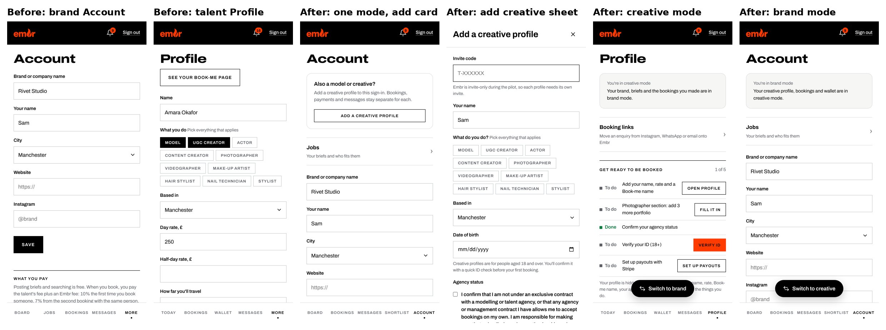

# Brand and creative modes on one sign-in

Status: built on a PR stacked on the Shoot Roster PR, held for Luke's final UI round (not merged, not deployed). 2026-11-25.

## What the apps on Mobbin do (iOS, checked 2026-11-25)

| App | Pattern | Screens |
|---|---|---|
| Airbnb | Profile tab shows a "Become a host" card for people who don't host yet, and a black "Switch to hosting" pill floating above the tab bar. Tapping it shows a full-screen "Switching to hosting" moment, then a different 5-tab bar (Today, Calendar, Listings, Messages, Menu). Menu ends with "Switch to traveling" in the same spot. | [Profile](https://mobbin.com/flows/992431f9-6c6a-4ce1-aecd-53dc74796f28) · [Switching to hosting flow](https://mobbin.com/flows/667e933d-17bb-4969-a4a6-a1067add6812) · [Host menu](https://mobbin.com/flows/fcd9af7a-45d2-4bc7-a4d7-f0b5ce52442a) |
| Fiverr | "Seller mode" switch at the top of the profile menu. Seller mode recolours the header, swaps the menu (Earnings, Briefs, Share my Gigs) and drops the tab bar from 5 to 4. | [Buyer menu](https://mobbin.com/screens/dc363815-f40c-459b-828b-5ee5eecb46ac) · [Seller mode on](https://mobbin.com/screens/82e54113-09f1-4e48-9f3e-57103e0ed08b) · [Seller menu](https://mobbin.com/screens/40a5f23b-d3e9-4f0d-ad2e-49fa2a17cde9) |
| Uber | No in-app switch between rider and driver: drivers use a separate app. The rider app only switches ride profiles (Personal or Business) inside Wallet and filters. | [Wallet ride profiles](https://mobbin.com/screens/efe180bf-51f0-47e4-9e3c-b5d35df63a6d) · [Profile filter](https://mobbin.com/screens/abce2387-4246-4db1-97a3-77bb9f5b725a) |

Mobbin has no Android library, so the Android notes in DESIGN_RULES.md still apply. Nothing here is iOS-only: the pill and tab bars are plain web.

## What Embr does

- **Phone tab bar per mode, 5 labelled tabs, Account or Profile last** (DESIGN_RULES 1.1, 1.2, 1.7). Brand: Board, Bookings, Messages, Shortlist, Account. Creative: Today, Bookings, Wallet, Messages, Profile. The "More" tab is gone. Jobs (brand) and Booking links (creative) are rows at the top of the last tab, which stays lit while they're open, and carries their dot. The desktop header still lists every destination.
- **Switch** (Airbnb): a black "Switch to creative" / "Switch to brand" pill floating above the phone tab bar, on Account or Profile only. Desktop: a "Switch to …" link in the header and a button in the mode panel. Black, not orange (DESIGN_RULES 4.3).
- **Switching moment** (Airbnb): a full-screen white "Switching to creative mode" screen with the Embr logo while the server saves the mode, then the new tab bar on its first tab. Skipped when reduced motion is on.
- **Add the other mode** (Airbnb "Become a host"): people with one mode see a card "Also a model or creative?" or "Run a brand as well?". It opens a bottom sheet with an invite code and the same fields as joining. A wrong code keeps the sheet open.
- Chose Airbnb's pill over Fiverr's switch because Airbnb changes the whole tab set like Embr does, and a switch reads as a setting rather than a place to go.

## How it works in the database (`supabase/migrations/20261125000007_dual_mode.sql`)

- `profiles.role` now means the **active** mode. Every function already checks it, so nothing is loosened. A person holds a mode when they have the matching `brands` or `talents` row.
- `switch_mode(role)` changes it only to a mode the person holds. Staff accounts can't switch or add a mode.
- `add_mode(role, invite, data)` needs an unused invite for that mode (Embr stays invite-only), and for a creative profile the same 18+ date of birth, roles and agency declaration as joining.
- `_can_see` now checks the active mode as well as the id, so creative mode can't open the person's brand bookings and the other way round.
- Triggers stop anyone booking or saving their own creative profile, and their own visits don't count as brand views. The board also hides the person's own card.
- Payments are untouched. The payment functions already find each side from `bookings.brand_id` and `talent_id`, which can no longer be the same person.

## Questions for Luke (not decided here)

1. **Can a creative also hold a brand profile?** In brand mode they'd see other creatives' day rates, dates and rankings on the board. That's what any brand sees, but it is a competitor looking. Today it is gated by needing a brand invite from staff. Options: allow it, allow it only for real brands staff check, or allow brand → creative only.
2. **Employment-agency line.** Creative mode still can't see briefs, the board or offers, so nothing here lets talent browse or apply. But one person holding both sides may need a line in the BPP review (D4/D6) so it isn't read as a way round "talent can't see jobs".
3. **Subscription.** If talent pay a subscription, does a brand that adds a creative profile pay it too? The subscription isn't built yet, so nothing changes now.
4. **Notifications** are per person, not per mode, so a brand-side alert shows in creative mode. Tapping a booking alert from the other mode says "Booking not found" until they switch. Possible follow-up: tag each alert with its mode and offer to switch.
5. **Naming.** This uses "creative mode" (Luke's word in the request). Memory says the marketer should settle "talent" vs "creative".
