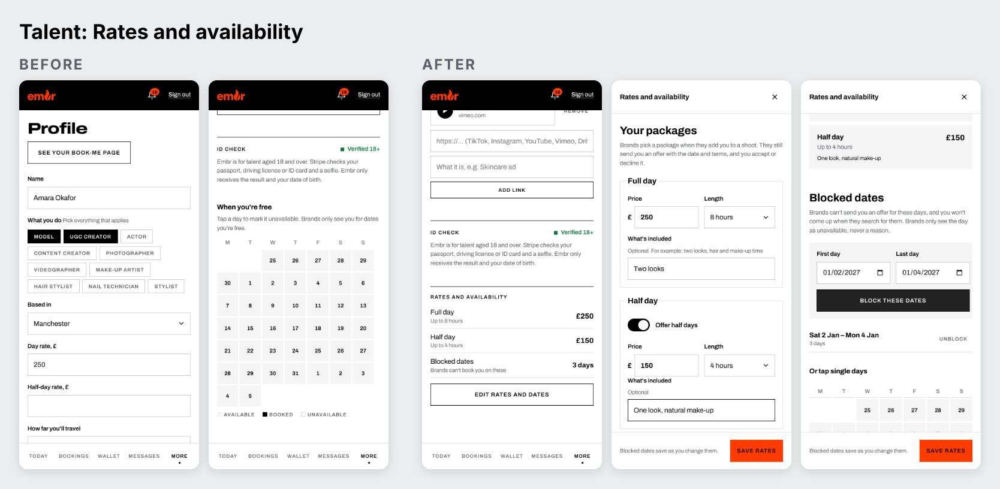
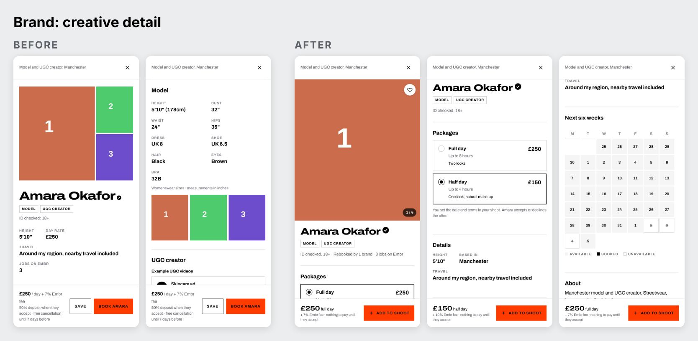

# Rates and availability editor, and the brand-facing creative detail screen

Status: built 2026-11-25, held for Luke's final UI round (not merged, not deployed). Stacked on PR 29 (Shoot Roster), which sits on PR 28 and PR 27.

## What talent get: Rates and availability

1. **A summary card on Profile** in place of the two rate boxes and the loose calendar: Full day and Half day with price and hours, how many dates are blocked, and "Edit rates and dates". A new talent with no rate sees "Set your rates", and "Get ready to be booked" lists "Set your day rate" as its own step.
2. **A full-screen editor** (X at the top, one sticky Save, DESIGN_RULES 3.2):
   - **Full day:** price, length (4 to 12 hours, 8 by default) and an optional "What's included" line.
   - **Half day:** behind an "Offer half days" switch. Price, length (1 to 6 hours, 4 by default), "What's included". The half-day price must be below the full-day price.
   - **How brands see it:** a live preview of the package rows exactly as brands will see them.
   - **Blocked dates:** First day and Last day, then "Block these dates". Blocked ranges are listed with Unblock, and the month grid below still takes single taps. Blocking saves straight away; brands only ever see the day as unavailable, never a reason.
3. "Edit dates" on Today now opens this editor.

## What brands get: the creative detail screen

A pushed full screen with the tab bar covered and one sticky bar (DESIGN_RULES 1.6 and 3.3, since it leads to a booking):

1. **Photos edge to edge**, swiped sideways, then the showreel tile when there is a video link. A "1 / 4" counter and a round white heart (DESIGN_RULES 2.4).
2. **Name, roles and a trust line:** ID checked, "Rebooked by N brands" and jobs on Embr, only when true.
3. **Packages:** Full day and Half day as tappable rows with price, hours and what's included. The picked one sets the price in the bar.
4. **Details, next six weeks** (blocked and booked days shown), **about** and **work by role**, as before.
5. **Sticky bar:** the picked package's price, the Embr fee line, and **Add to shoot**. It opens the same "Add to shoot" sheet and Shoot Roster from PR 29. "Send Amara an offer on their own" stays as a link under the profile.

## How packages feed the offer (payments unchanged)

- A package only fills the existing `day_rate` and `days` of an offer. Full day: the full-day price for the shoot's days. Half day: the half-day price for one day.
- In the Shoot Roster the person's row says "Half day · up to 4 hours · one day", and the combined cost quotes them for one day at £150. The single offer form gets Full day / Half day chips that fill the rate.
- The offer's notes start with "Package: Half day, up to 4 hours. Includes: …" so the creative sees what was picked. If the brand changes the rate, the line is left out so nothing contradicts the rate.
- `quote()`, `create_offer()`, deposits, holds, `payments.ts` and Stripe are not touched. A db test checks a half day quotes through the same `quote` as any offer.
- Not built, flagged: bookings don't store which package was picked, so a half-day booking reads "1 day at £150" on the booking screen (the package is in its notes). A `bookings.package` column and a label on the booking screen would fix that; it needs `create_offer` changes, so it's left for Luke to decide.

## Database change for the final round

`supabase/migrations/20261125000007_rate_packages.sql` (needs `npx supabase db push` with the final round, after `20261125000006_card_media.sql` from PR 28):

- `talents.packages jsonb` (hours and "what's included" per package; prices stay in `day_rate` and `half_rate`)
- `_talent_card()` returns `packages`
- new `save_rates(p)` (talent only; checks rates and hours) and `set_off_range(from, to, off)` (talent only; up to three months at a time, no past dates)

Brands could already see day and half-day rates, so nothing new about money is exposed.

## Mobbin evidence (iOS, checked 2026-11-25)

Mobbin has no Android library, so these are iOS references. Fiverr, Peerspace, Booksy and Airbnb are all on Mobbin; Airbnb's host calendar isn't, so the blocking pattern comes from Fiverr and Peerspace.

| Choice | Screens |
|---|---|
| Two or three priced packages on a provider's page, each with what it includes | [Fiverr gig, package tabs](https://mobbin.com/screens/0c80d160-f566-4576-84ab-07ca38c8c6a7) · [Fiverr package details and Continue](https://mobbin.com/screens/ce1ed159-5718-475a-9303-645645997f82) · [Booksy service options with price and duration](https://mobbin.com/screens/f8e8b4ec-382f-4c67-a835-1152c195079b) · [Airtasker price package](https://mobbin.com/screens/55a29185-d710-4ae2-92d6-f36ce8b2eee9) |
| Packages as rows with price on the right (picked over Fiverr's tabs, because with two packages both fit on screen) | [Booksy services list](https://mobbin.com/screens/06d5845e-b8d2-4046-a453-772b540f83b7) · [Booksy service options](https://mobbin.com/screens/8cae9564-d270-4523-9a6d-760f2a4e3985) |
| Editing a package: label, length and price as simple rows | [Fiverr "Create an offer"](https://mobbin.com/screens/9d518af8-f1e1-437d-940f-fa4ec1a2f286) · [Linktree "Add a booking type"](https://mobbin.com/screens/52e76429-4faf-4260-b0d6-ed12cb892dc4) |
| Blocking dates: first day, last day, confirm | [Fiverr "Set unavailable dates"](https://mobbin.com/screens/0d6b8260-ebc7-4bd5-a099-e24bc5829148) · [Peerspace "Block time"](https://mobbin.com/screens/b761b291-2491-4a3e-ba9a-0b91eac1cf8a) |
| Unavailable days struck through on a calendar | [Airbnb "When?"](https://mobbin.com/screens/e090afc7-43f5-4bbf-b5d8-aacb554ed5ca) |
| Provider header: photos edge to edge, counter, round heart and share | [Booksy profile](https://mobbin.com/screens/e9a12058-e861-4e5c-b28a-7c6b61018146) · [Booksy profile 2](https://mobbin.com/screens/deb36237-282a-461f-abad-ba0d6f46ca5a) · [Fiverr gig "1 of 3"](https://mobbin.com/screens/0c80d160-f566-4576-84ab-07ca38c8c6a7) |
| Sticky bar: price on the left, one action on the right | [Peerspace listing](https://mobbin.com/screens/27bae7bd-29ef-4c85-af58-d880120ab842) · [Peerspace listing 2](https://mobbin.com/screens/ca59de9e-3cf4-4f93-988b-cf9c0118b1b0) · [Airbnb "Meet your host" with Reserve](https://mobbin.com/screens/f5de44f9-d5f8-4bb7-afd2-b8eceeb9ce57) · [Booksy service with Book](https://mobbin.com/screens/07bf2fc9-21c1-4638-8a77-ec6c555f0b19) |

DESIGN_RULES.md: the editor is a full-screen modal with X and a sticky Save (3.2). The detail screen is a pushed screen covering the tab bar with one sticky action (1.6, 2.3, 3.3). The "Add to shoot" sheet on top stays a short sheet (3.1). Every tap target is at least 48px, checked in the browser test (2.2). The heart sits on a solid round button (2.4). Black for selected packages and the Block button, orange only on the one primary action (4.2, 4.3).

Rule not followed exactly: Booksy shows "Book" on every service row. Embr keeps one action in the bar instead, because DESIGN_RULES 2.3 allows one primary action per screen and brands go through the Shoot Roster.

## Before and after

## Files

`src/views/rates.js` (new: packages, editor, blocking), `src/views/brand.js` (detail screen, offer form package chips), `src/views/roster.js` (package on each person, one day for a half day), `src/views/talent.js` (summary card, readiness step), `src/ui.js` (a layer underneath keeps its scroll position), `src/style.css`, `supabase/migrations/20261125000007_rate_packages.sql`, `tests/db.test.mjs`, `tests/e2e.test.mjs`.
