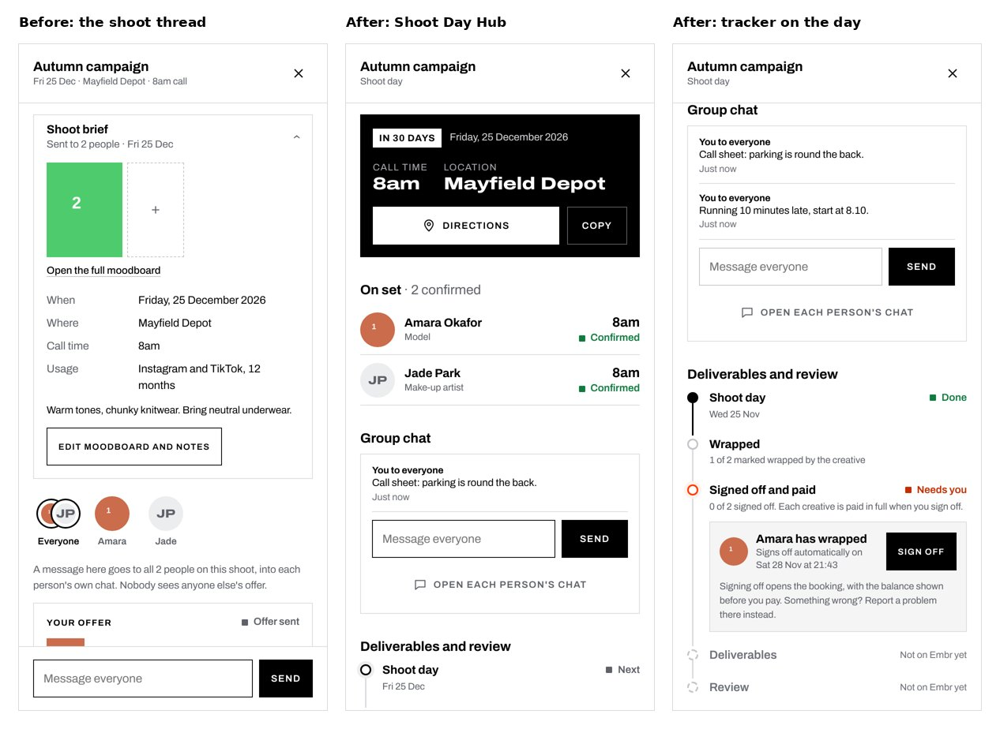

# Shoot Day Hub

Status: built 2026-11-25, held for Luke's final UI round (not merged, not deployed). Stacked on PR 32 (Shoot Thread), which sits on PR 31, 29, 28 and 27.

Luke's ask (2026-11-25): an active Shoot Day Hub with the confirmed roster, call times, one-tap map directions to the location, group chat, and a post-shoot "Deliverables & Review" milestone tracker, based on trip, event and order-tracking screens.

## What the brand gets

Once anyone on a shoot is confirmed (deposit paid), tapping the shoot on Bookings opens its day screen instead of the thread. The thread gets a black "Shoot day" bar at the top to reach it as well.

1. **Day band** (black, DESIGN_RULES 4.7): "In 30 days", "Tomorrow" or "Today", the full date, the call time and the location in large type, then **Directions** and **Copy**.
2. **Directions** is a plain link. On iPhone and iPad it opens Apple Maps (`maps.apple.com/?daddr=`), everywhere else Google Maps (`google.com/maps/dir/?api=1&destination=`). Both open the installed app and need no key or paid API. Sources: [Apple Map Links](https://developer.apple.com/library/archive/featuredarticles/iPhoneURLScheme_Reference/MapLinks/MapLinks.html), [Google Maps URLs](https://developers.google.com/maps/documentation/urls/get-started), both checked 2026-11-25. Creatives get the same Directions button on their own booking once they've accepted.
3. **On set**: the confirmed people as a call sheet. Face, name, role, their call time (from their own booking) and status (Confirmed, Wrapped, Paid). A row opens that person's chat in the shoot thread. People still answering sit in a folded "N more not confirmed yet".
4. **Group chat**: the latest three shoot messages and one composer. It uses PR 32's `shoot_message_all`, so a message lands in each person's own booking chat and nobody sees anyone else's. The copies show once, as "You to everyone". "Open each person's chat" goes to the thread.
5. **Deliverables and review**: a vertical tracker.
   - Shoot day: done once the date has passed or someone has wrapped.
   - Wrapped: "1 of 2 marked wrapped by the creative".
   - Signed off and paid: "0 of 2 signed off. Each creative is paid in full when you sign off." When anyone has wrapped, this step turns orange ("Needs you") and opens a card per person with their automatic sign-off time and a **Sign off** button. That button opens the existing booking screen, which shows the balance before paying (DESIGN_RULES 3.3).
   - Deliverables and Review: shown as "Not on Embr yet", with a line saying to agree deliverables in messages for now.

Nothing on the hub shows money (the test checks there's no "£" on it). Money stays on each booking and the shoot checkout.

## Rules kept

- **Payments untouched.** The tracker only reads booking statuses (`confirmed`, `wrapped`, `completed`) and `auto_signoff_at`. Sign-off is the existing booking action, so talent are still paid at sign-off on completion. No change to `payments.ts`, Stripe or any Edge Function.
- **No database changes.** Everything comes from PR 32's `shoot_detail`.
- **Agency line.** Talent see nothing new about other creatives. The hub is brand-only; creatives get Directions on their own booking.
- **Orange only for "needs you"** (4.3): the sign-off step. Before the shoot the current step is black ("Next").

## For the final round: deliverables and reviews need new data

Embr has no reviews and no deliverables today (`src/views/card.js` already says ratings only show when real data exists). To make the last two steps live, the smallest version would be:

- `booking_deliverables`: `booking_id`, `kind` (`images`, `video`, `link`), `url` or storage path, `note`, `added_by`, `created_at`, plus `bookings.deliverables_due date` set in the offer. Who adds them depends on the role: a photographer or videographer delivers files to the brand; for a model it's usually the brand sharing selects. That's a product call for Luke.
- `reviews`: `booking_id` (unique), `brand_id`, `talent_id`, `stars smallint 1-5`, `body`, `created_at`, brand-to-talent only, allowed once the booking is `completed`. RLS: the brand writes its own, everyone reads published ones; a `talent_rating` view would feed the CreativeCard star line from PR 28.
- Neither touches money. Review copy and any public star rating need Luke's OK (and probably CAP Code checks) before real use.

## Mobbin evidence (iOS, checked 2026-11-25)

Mobbin has no Android library, so these are iOS references. Eventbrite, Airbnb and Uber all came up by name.

| Choice | Screens |
|---|---|
| When and where first, in a big block | [Airbnb trip with Check-in / Checkout](https://mobbin.com/screens/10dcd39f-1887-45df-855d-0cfd7ebfb04f) · [Airbnb pending trip](https://mobbin.com/screens/eba2815a-8ded-4352-a19c-f0da3352df29) · [Eventbrite ticket with date and time](https://mobbin.com/screens/9aa88ec6-82a1-46e0-ae92-df1a9c9f7306) |
| Itinerary as a dated list | [Airbnb trip itinerary](https://mobbin.com/screens/6e4ecccc-0936-4914-8df2-3e9ccd206e21) · [Airbnb itinerary on the map](https://mobbin.com/screens/f062fe34-de67-40e2-9658-3920dfc8d890) |
| Meeting point, the person you're meeting and a way to message them | [Uber "Meet at your pickup spot"](https://mobbin.com/screens/76380627-b6b3-4a58-8e6d-858d0cc2dc27) · [Airbnb "Message your host" row](https://mobbin.com/screens/10dcd39f-1887-45df-855d-0cfd7ebfb04f) |
| Vertical tracker, done / now / later | [CVS order steps](https://mobbin.com/screens/6ade5a53-e2a8-423e-b5d9-c135e5bf010c) · [X Card stepper](https://mobbin.com/screens/485ba275-39a1-4d3f-8e1c-b99c798ddd01) · [Bolt Food timed steps](https://mobbin.com/screens/9509b853-f44c-425e-81c0-c6e96efffe2c) |
| The current step opens as a card with its action | [Vestiaire Collective "In progress" card with Contact seller](https://mobbin.com/screens/984bf280-8384-4125-8136-360fc80eddf2) · [DoorDash Dasher timed steps](https://mobbin.com/screens/c94818d5-5d48-461f-8ba8-ac4aabc9d626) |
| Event links under the ticket | [Eventbrite event and order details](https://mobbin.com/screens/f797b011-d71c-4fce-a2a4-041bd2ec030c) |

Uber Eats only came up with checkout and "preparing your order" screens (no step tracker), so it's not cited for the tracker.

DESIGN_RULES.md: the hub is a full-screen panel like the shoot thread (3.3, it leads to sign-off). Every tap target is at least 48px (2.2, checked in the browser test for roster rows, Directions, Copy, the composer and the chat link). Black band and black main actions (4.2, 4.7); orange only for the sign-off step (4.3). No sheet on a sheet: from the thread, "Shoot day" goes back to the hub instead of stacking a second one (3.5).

## Before and after

## Files

`src/views/shootday.js` (new), `src/views/shoot.js` (Shoot day bar, Bookings opens the hub once confirmed), `src/views/booking.js` (Directions on the booking), `src/icons.js` (pin and chat), `src/ui.js` (`belowTop`), `src/style.css`, `tests/e2e.test.mjs`.

## Tests

- e2e 45 (was 44): the hub opens from Bookings, two confirmed rows with 8am, Directions links to Google Maps for Mayfield Depot in a new tab, no money on the screen, 48px targets, a group message reaches both chats and shows once, a roster row opens that person's chat, Amara's booking has Directions, after she wraps the sign-off step needs the brand with her auto sign-off time, signing off from the hub completes her booking through the existing flow, and the tracker then reads 1 of 2 signed off.
- db 94, unchanged (no database changes).
