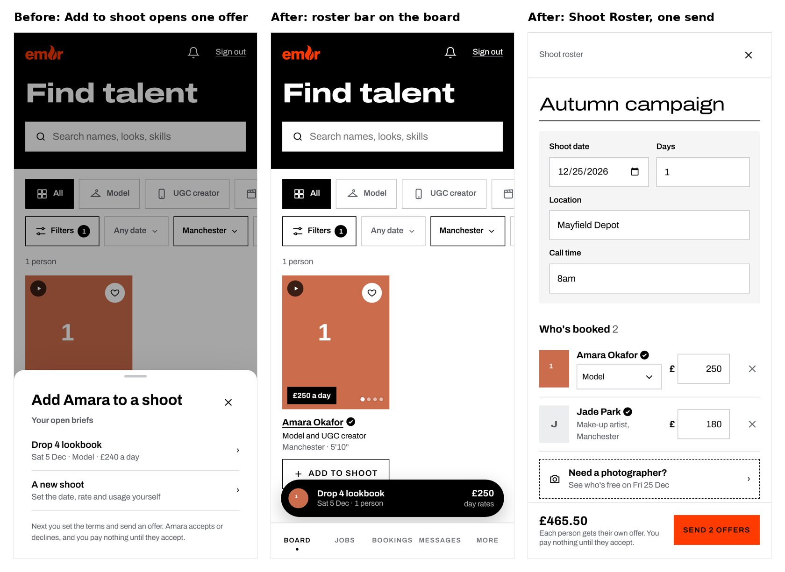

# Shoot Roster

Status: built 2026-11-25, held for Luke's final UI round (not merged, not deployed). Stacked on PR 28 (CreativeCard), which sits on PR 27.

## What a brand gets

1. **"Add to shoot" leads to a roster.** The sheet from PR 28 now lists the brand's shoot rosters first, then open briefs to start one from, then "A new shoot". Picking one adds the creative and keeps the brand on the board. A new shoot opens the roster straight away to name it and set the day.
2. **Roster bar on the board.** A black bar above the tab bar shows the shoot, its date, how many people and their day rates added up. Tapping it opens the roster.
3. **The roster screen.** One shared name, date, days, location and call time for everyone. One row per creative with the role they're booked as and their day rate (both editable) and a remove button. Usage, what they'll be asked to do and notes are shared too.
4. **Missing roles.** Up to three "Need a make-up artist?" style rows. On-camera talent (model, actor, UGC or content creator) prompt for a photographer (not when a videographer or UGC creator is already in), make-up artist, hair stylist and stylist. A crew-only roster prompts for a model. Tapping one returns to the board on that role, filtered to people free on the shoot date.
5. **Combined cost.** Each person's fee, the Embr fees added up, the total, deposits and balances. Each line is the same server `quote` the single offer form uses, so first, repeat and loyal fee rates still apply person by person.
6. **One send.** "Send 3 offers" with one agreement tick. Under the hood it calls `create_offer` once per creative with the shared details. If one fails (say, someone isn't free that day) the others still go and the failed row stays in the roster with the reason.

## What did not change

- **Payments and holds.** Each creative still gets their own booking, accepts or declines on their own, and the brand pays each 50% deposit when that person accepts, then each balance at sign-off. No change to `payments.ts`, Stripe or the database.
- **A true combined payment would need payment work.** Paying all deposits in one Stripe Checkout would need a new Edge Function that creates one Checkout Session across several bookings and splits the transfers per booking, plus a rule for what happens when only some people accept. Not built; flagged for Luke.
- **Brand-only.** Talent never see "Add to shoot" or the roster, and `create_offer` still refuses anyone who isn't a brand. Nothing here lets talent apply.
- **Drafts live on the device.** A roster is kept in the browser (localStorage, per brand account) until it's sent. It won't follow the brand to another phone. A `shoot_drafts` table could replace this in the final round if Luke wants that.

## Mobbin evidence (iOS, checked 2026-11-25)

Mobbin has no Android library, so these are iOS references.

| Choice | Screens |
|---|---|
| Bar on the browse screen with count and total, opening the basket | [Instacart](https://mobbin.com/screens/3ac9546a-1fa6-4282-8bac-2d067b271132) · [Blinkit](https://mobbin.com/screens/a97c5723-adaa-451a-9677-51672e0b0373) · [Skip](https://mobbin.com/screens/ce50ef8b-05a6-4006-ac96-9400caa3dbaf) · [DoorDash](https://mobbin.com/screens/b03e5541-3018-4763-b128-e7a896d4137f) |
| Shared when and where at the top of a group order | [Uber Eats group order](https://mobbin.com/screens/0d9e20bc-cae2-40ea-8a66-1b5fe1d9593c) · [Zomato group order](https://mobbin.com/screens/c6811c23-65d0-496e-b9af-19aae2cf120e) · [Wolt "Order together"](https://mobbin.com/screens/0b5439ed-8560-400a-baa7-2607eb7d5837) |
| One row per person with their items and amount | [Shopee Group Basket](https://mobbin.com/screens/3702e7cd-bb48-4860-813d-003a02076321) · [Grab Review Order](https://mobbin.com/screens/673139c1-be52-4234-a0b4-719ff5bb81f9) · [Uber Eats](https://mobbin.com/screens/0d9e20bc-cae2-40ea-8a66-1b5fe1d9593c) |
| Missing pieces shown as rows to add | [Navan "Add to trip" with Book](https://mobbin.com/screens/78917e60-ccbb-419f-86ea-cabffb873df7) · [Trainline "Add a car / Add a place to stay"](https://mobbin.com/screens/4344fccd-5dc2-4498-8dcc-4c4feff383b6) · [Agoda trip "Suggested"](https://mobbin.com/screens/1c7095ff-9e75-446b-86e3-982d9c99b173) |
| Several drafts at once | [DoorDash Open Carts](https://mobbin.com/screens/b03e5541-3018-4763-b128-e7a896d4137f) |
| Itinerary grouped by one date and place | [Airbnb Trips](https://mobbin.com/screens/b291836f-b8de-4872-8162-5cc4585728a9) · [Mindtrip itinerary](https://mobbin.com/screens/a2289d37-62bf-4f22-b7f6-aa8e8855c459) |
| Price breakdown before a request, then the host confirms | [Airbnb Request to book](https://mobbin.com/screens/ef0e240d-a5d2-465c-bf1c-c34833b1a0c8) · [DoorDash summary](https://mobbin.com/screens/18e4ba52-30bb-4fbe-ac20-1ccd90833ac8) |

Eventbrite came up only with ticket and refund screens, no multi-ticket checkout, so it isn't cited.

DESIGN_RULES.md: the roster is a pushed full screen with a sticky footer (3.3, it ends in offers that commit money), the add sheet stays a short sheet (3.1), every tap target is at least 48px (2.2), black for the bar and primary surfaces with orange only on the send button (4.2, 4.3).

## Before and after

## Files

`src/views/roster.js` (new), `src/views/card.js` (old sheet moved out), `src/views/brand.js` (`board-find`), `src/main.js` (bar shows on the board only), `src/style.css`, `tests/e2e.test.mjs`.
