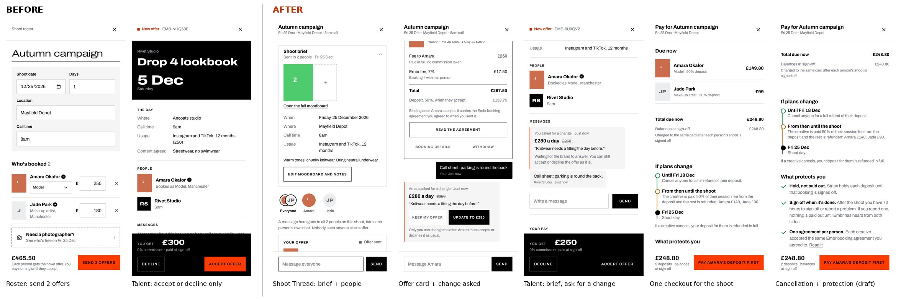

# Shoot Thread

Status: built 2026-11-25, held for Luke's final UI round (not merged, not deployed). Stacked on PR 31 (rates and creative detail), which sits on PR 29 (Shoot Roster), PR 28 and PR 27.

Luke's ask (2026-11-25): a Shoot Thread where a brand sends one shoot brief (moodboard, call time, location) to the creatives they picked, gets binding "Custom Offer" cards in the chat, and finishes with one checkout that has clear cancellation and protection terms.

## What a brand gets

1. **One shoot brief.** The roster now has a "Shoot brief" section: moodboard images (up to 12, uploaded to the brand's own folder), an optional moodboard link and notes for everyone. "Send N offers" first saves the shoot, then sends one offer per person. Every offer takes the title, date, place, call time and usage from the shoot, so nobody gets a different version.
2. **The Shoot Thread.** After sending, the brand lands on a full screen for the shoot: the brief pinned at the top (folds away once people are talking), then a row of people chips ("Everyone" plus one per creative, with an orange dot when someone needs the brand).
3. **Offer cards in the chat.** Each creative's chat opens with the brand's offer as a card: role, date, fee to the creative, Embr fee, total, the deposit, and "Binding once they accept: it carries the Embr booking agreement". Buttons: Read the agreement, Booking details, Withdraw.
4. **Change requests.** If the creative asks for a change, a card appears in their chat ("£280 a day, was £250", plus their note). The brand taps "Update to £280" or "Keep my offer". Updating re-prices the offer with the same fee rules as a new offer, rewrites its booking agreement (the brand agrees to the new version) and tells the creative, who then accepts or declines as usual.
5. **Message everyone.** On "Everyone", one message goes into each creative's own booking chat. Nobody sees anyone else's chat, offer or rate.
6. **One shoot checkout.** When people accept, an orange bar sits over the composer: "Pay 2 deposits · £248.80". It opens one checkout: every deposit due, who has paid, who hasn't answered yet (their deposit is only due if they accept), the balances due at sign-off, a cancellation timeline and "What protects you".
7. **Bookings tab.** Shoots are listed first, with faces and what needs the brand (deposits to pay, changes asked, new messages).

## What a creative gets

On their own offer: "The shoot brief" (moodboard, link, notes), the brand's messages, and "Ask [brand] for a change": a short sheet with the day rate and a note. They can ask once at a time, and only before answering the offer. Their request shows as a card with "Waiting for the brand to answer. You can still accept or decline the offer as it is."

## Questions for Luke (flagged, not decided)

1. **Creative-sent "Custom Offers".** Fiverr-style, where the creative writes and prices their own offer, would mean talent proposing work and setting terms on their own. That cuts against the agency position (docs/decisions.md, 2026-11-20: brands make offers, talent accept or decline, talent can't message brands about jobs). So this build gives the "binding offer card" to the brand, and the creative gets **Ask for a change** on an offer the brand already sent. Only the brand can change the offer. If you want creatives to send their own priced offers, it's your call and probably one for the BPP review too.
2. **A true single payment.** The checkout is one screen, but each deposit is still its own Stripe Checkout, opened one after another ("Pay Amara's deposit first", then the next). The brand's card is saved after the first. A single card payment for the whole shoot would need: a new Edge Function that creates one Checkout Session with a line per booking and one `transfer_group`, the webhook marking every deposit paid from that one payment, refunds and late-cancellation transfers split per booking from one charge, and a rule for when only some people accept (charge as each accepts, or wait for all). That changes how holds and payouts work, so it isn't built. Payments code, Stripe and `payments.ts` are untouched.
3. **Cancellation and protection wording.** Every line in the checkout comes from the existing booking agreement (sections 4a, 4c, 7a to 7c and 8) and the settings (7 days, 50%, 72 hours). Nothing new is promised. The screen carries "Draft terms for the invite-only pilot, taken from the Embr booking agreement. They are waiting for solicitor review and may change." It's brand-facing legal wording, so it needs your OK (and BPP's) before real brands see it.
4. **Moodboard privacy.** Moodboard images use the existing public `photos` bucket (brand's own folder, unguessable file names), like portfolio photos. A private bucket with signed links would be tighter if brands upload unreleased product.

"Book now, pay later" is kept out of the copy.

## Database changes for the final round

`supabase/migrations/20261125000008_shoot_thread.sql`, after 000007 from PR 31:

- New table `shoots` (the shared brief, moodboard paths, link) and `bookings.shoot_id`.
- New table `offer_changes` (one open request per booking).
- New functions: `create_shoot`, `shoot_offer` (calls the existing `create_offer` with the shoot's details), `update_shoot` (moodboard, notes and link only; date, place and call time are in each agreement), `shoot_detail` and `my_shoots` (brand only), `shoot_message_all`, `booking_shoot` (the brief on one booking, for its brand or creative), `ask_change` (talent, unanswered shoot offers only), `answer_change` (brand).
- Both tables have row level security on with no policies, so they're only reachable through these functions.

## Mobbin evidence (iOS, checked 2026-11-25)

Mobbin has no Android library, so these are iOS references.

| Choice | Screens |
|---|---|
| Offer as a card inside the chat, with price and a main action | [Fiverr custom offer](https://mobbin.com/screens/6b92e5d7-7a9f-4455-935f-ced815aabd2d) · [eBay "sent an offer"](https://mobbin.com/screens/edea69a7-cbd7-40b3-a1b8-d919d147aeac) · [Airbnb "Requested" card](https://mobbin.com/screens/b979a3d6-ce7f-4f70-9cd4-7b892d8650cc) |
| Accept, decline or ask for a different price | [Vinted Accept / Decline / Offer your price](https://mobbin.com/screens/63834367-46bf-49a0-90ac-89dd355cea9f) · [Peerspace host sends an updated offer after a request](https://mobbin.com/screens/622b2dde-2223-4910-beea-87bc8adc512e) · [Depop "An offer is not a payment"](https://mobbin.com/screens/2135e249-6484-4728-959a-7880867f1f7b) |
| The booking pinned at the top of the chat | [Airbnb host chat with trip details](https://mobbin.com/screens/b979a3d6-ce7f-4f70-9cd4-7b892d8650cc) · [Airtasker task header](https://mobbin.com/screens/90ccf674-ed0c-48ff-88d5-b91b872c4d6f) · [Lex event card in a group chat](https://mobbin.com/screens/93e0fb0b-fa73-4ade-aa26-a9a64834f5cd) |
| Who's in the conversation | [Airbnb "In this conversation"](https://mobbin.com/screens/8155eb0a-f4f6-4faa-86b0-9f9eabb8ac00) |
| Sticky pay button under the composer | [Airbnb "Complete Booking"](https://mobbin.com/screens/a3e84b35-cc3e-4f8c-9879-1a1e6634d3a3) |
| Checkout with a cancellation row and agreement line | [Peerspace checkout](https://mobbin.com/screens/afe2414e-5288-45d0-a03c-fa025cf74233) · [Vrbo policies before paying](https://mobbin.com/screens/e8d7ea12-b51f-4563-b75b-efe023cabe21) |
| Cancellation as a timeline | [Agoda "How much will it cost to cancel?"](https://mobbin.com/screens/da8298c2-cd06-47e2-98ae-0132ec3da04f) · [Navan change and cancellation policy](https://mobbin.com/screens/5d9e8730-684d-4ee2-8439-8213fa8ea7dd) |
| Money held until the job is done, protection line | [Airtasker "Securely hold payment"](https://mobbin.com/screens/e82b8d99-374e-4c77-96c7-0facc2be1501) · [Artsy "Your purchase is protected"](https://mobbin.com/screens/03b29c37-051d-4adb-ad81-a17a96dc6a56) · [Upwork contract with escrow amount](https://mobbin.com/screens/75535eb9-a24b-49c3-a57d-7fb784a20061) |

Upwork came up only with its contracts list, not a milestone checkout, so it's cited for the escrow line only.

DESIGN_RULES.md: the thread and checkout are pushed full screens with sticky footers, because they commit money (3.3). "Ask for a change" and "Moodboard and notes" are short sheets (3.1). Every tap target is at least 48px (2.2, checked in the browser test). Black for primary actions and the offer card; orange only for the pay bar, the pay button and "needs you" dots (4.2, 4.3).

## Before and after

## Files

`src/views/shoot.js` (new), `src/views/roster.js` (shoot brief, moodboard, sending through the shoot), `src/views/booking.js` (talent brief, change requests, carrying on the shoot checkout after Stripe), `src/views/brand.js` (Shoots on Bookings), `src/api.js` (`uploadImage`), `src/ui.js` (sheet class), `src/style.css`, `supabase/migrations/20261125000008_shoot_thread.sql`, `tests/db.test.mjs`, `tests/e2e.test.mjs`.

## Tests

- db 94 (was 82): shoots and refusals, shared details, privacy between creatives, change requests (who, when, once), re-pricing matches `quote`, agreement rewritten, message everyone, direct table access blocked.
- e2e 44 (was 43): moodboard upload, thread, message everyone, the creative asks for a change, the brand updates the offer, both accept, one checkout pays both deposits in turn, Shoots on Bookings, 48px targets.
